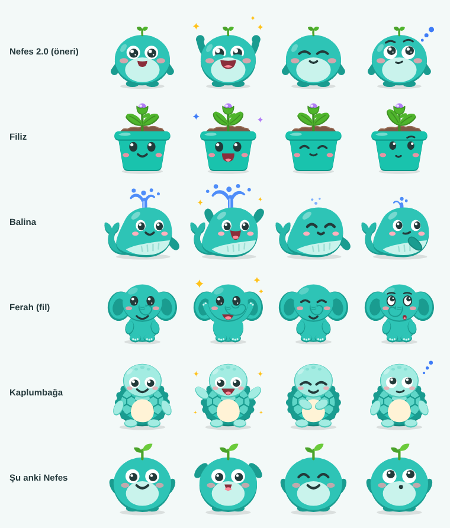

# Maskot önerileri

Unlit'in maskotu "Nefes" için 5 tasarım önerisi. Hepsi **elle yazılmış SVG
kodu**; yapay zekâ ile görsel üretilmedi. Basit şekillerden (daire, elips,
dikdörtgen, eğri) oluştukları için seçilen tasarım, uygulamadaki kodla çizilen
maskota (`lib/widgets/mascot.dart`, Flutter `CustomPainter`) birebir taşınabilir.

**Hepsini denemek için:** `galeri.html` dosyasını tarayıcıda aç. Ruh halini,
aksesuarları (gözlük, atkı, kulaklık, bere, kep, taç) ve büyüme aşamasını
değiştirerek bütün adayları yan yana görebilirsin.

## Adaylar

| Dosya | Aday | Fikir | Değerlendirme |
|---|---|---|---|
| `1-nefes-2.svg` | **Nefes 2.0** | Bugünkü Nefes'in devamı; başındaki filiz puanla 4 aşamada büyür, sonunda çiçek açar | **Öneri** (8,3/10) |
| `2-filiz.svg` | Filiz | Saksıda büyüyen fide | 6,4 — bitki "solar" kaygısı, tütün fidesi çağrışımı, şapkalar garip duruyor |
| `3-balina.svg` | Balina | Nefes almak için yüzeye çıkan balina | 6,0 — **elenmeli**: "Mavi Balina" (günlük görevli zararlı "oyun") çağrışımı |
| `4-ferah-fil.svg` | Ferah (fil) | "Ferah ferah nefes almak" | 6,0 — **elenmeli**: hortum nargile hortumunu çağrıştırıyor |
| `5-kaplumbaga.svg` | Kaplumbağa | "Yavaş ama emin adımlarla" | 5,9 — pastel, küçük boyutta soluk, şekil sayısı yüksek |
| `0-nefes-mevcut.svg` | Şu anki Nefes | Uygulamadaki maskotun birebir SVG kopyası | karşılaştırma için |

Puanlar iki ayrı otomatik inceleme turunun ortalamasıdır (kullanıcı gözü ve
uygulama gözü; çekicilik, uyum, okunurluk, aksesuar sistemi). **İnsan testi
değildir.** Karar vermeden önce 5–8 yetişkin sigara içiciye (40 yaş üstü
erkekler dahil) gösterip "Ciddiye alır mısın? Sana neyi hatırlatıyor?" diye
sorun.

Diğer adaylardan alınabilecek fikirler: düşünürken üç mavi nokta
(Kaplumbağa'dan, Nefes 2.0'a eklendi), nefes egzersizinde gövdenin nefesle
hafifçe şişip inmesi (Ferah'tan), ölçüm haftası kutlamasında kepin havaya
atılması (Balina'dan), "yavaş ama emin adımlarla" cümlesi.

## Dosya biçimi (katmanlar)

Her SVG `viewBox="0 0 200 200"`. Parçalar `class` ile gösterilir/gizlenir:

- class'ı olmayan her şey hep görünür (gövde, gölge, ayaklar).
- `mood-happy`, `mood-cheer`, `mood-calm`, `mood-think`: ruh haline özel
  parçalar (birden fazla yazılırsa hepsinde görünür).
- `acc-gozluk`, `acc-atki`, `acc-kulaklik`, `acc-bere`, `acc-kep`, `acc-tac`:
  aksesuarlar. `hide-acc-bere` gibi bir class, o aksesuar takılıyken parçayı
  gizler.
- `stage-1` … `stage-4`: büyüme aşamaları (kök `svg` üzerindeki
  `data-default-stage` varsayılanı söyler).

Dosyadaki sıra çizim sırasıdır (sonra gelen üstte). Sadece `g, circle, ellipse,
rect, path, line, polyline, polygon` kullanıldı; gradyan, filtre, maske, yazı
yok.

## Flutter'a taşırken (Nefes 2.0 seçilirse)

- Renkler koda tek tek yazılmasın; tek bir `MascotColors` tablosundan gelsin
  (ör. kutlamadaki "gülen alt kapak" gövde rengiyle aynı olmalı).
- Tekrarlanan çizimler tek fonksiyon olsun: yaprak (`drawLeaf`), kutlamada
  biraz aşağı kayan atkı (`drawScarf(dy)`).
- Filizin aşaması **saf bir fonksiyon** olsun (ör. `growthStage(totalXp)`,
  `lib/logic/`): sadece toplam puana bağlı, **asla geri gitmez**; sigara
  sayısına, sigarasız süreye ya da Aşama 6'daki enerji/sağlık göstergelerine
  bağlanmaz. Bunu gösteren bir test yazılsın, eşikler SPEC.md'ye eklensin.
- Painter okunaklı kalsın diye gövde, yüz, filiz ve aksesuarlar ayrı
  fonksiyonlarda/dosyalarda olsun.

## Puanla açılan dolap (öneri, karar bekliyor)

Puanlar para gibi **harcanmaz**; toplam puan hiç düşmez. Belli puanlarda ve
anlamlı anlarda eşyalar **açılır**, açılan eşya istenince takılır ve bir daha
kaybolmaz.

| Eşya | Ne zaman açılır |
|---|---|
| Güneş gözlüğü | 100 puan |
| Atkı | 250 puan |
| Kep | Ölçüm haftası bitince |
| Kulaklık | 500 puan |
| Yaprak taç | 7 günlük seri |
| Bere | 1000 puan |

Kurallar: aynı anda bir baş aksesuarı (bere, kep, taç ya da kulaklık) + bir
gözlük + bir atkı; sigara içmek hiçbir şeyi kilitlemez; sürpriz kutu ve
"sadece bugün" yok; tetikleyici eşya (fincan, bardak, kadeh, pipo, ateş) yok.
Eşikler öneridir (aktif bir günde yaklaşık 50 puan kazanılıyor).
